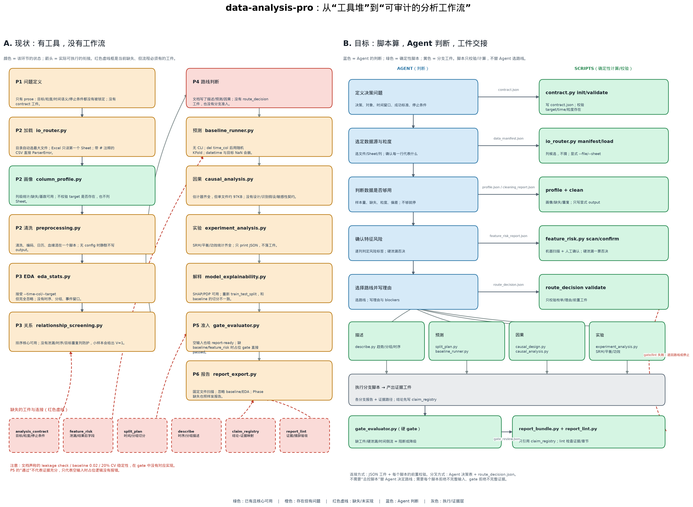
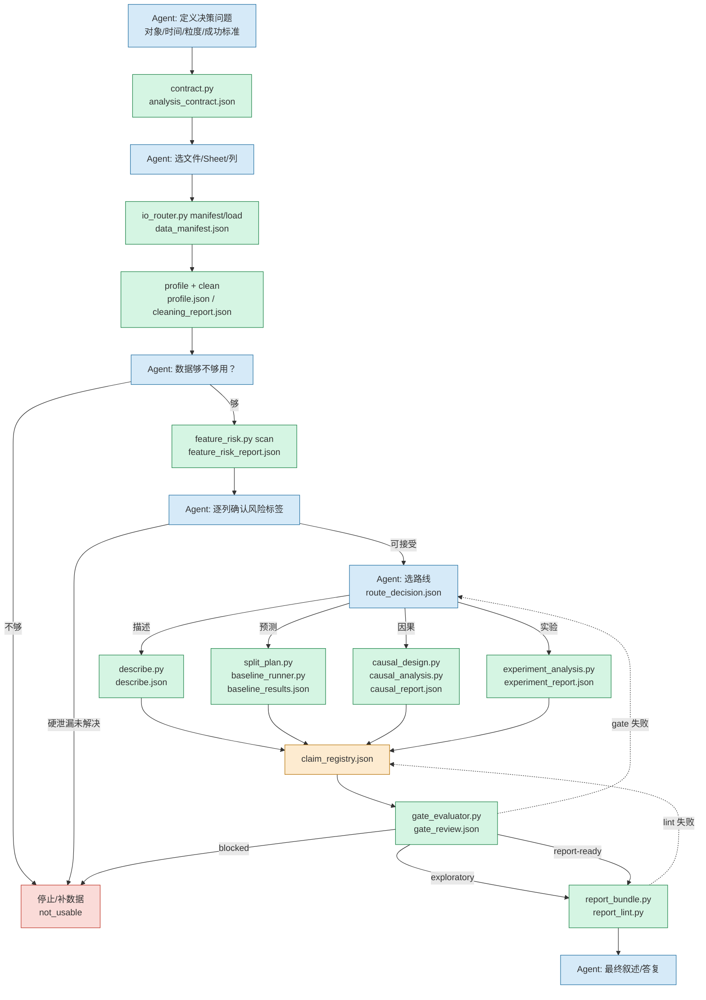

# 重构设计：从“工具堆”到“可审计的分析工作流”

> 这份文档解释为什么改、怎么分层、哪些步骤必须是脚本、哪些必须由 Agent 判断，以及分叉和连接如何表达。
> 图：

## 0. 结论先行

当前 skill 不是“原子化”，而是“散装”：

- 脚本边界按**实现方便**切，不按**决策点**切；`preprocessing.py` 同时做清洗、编码、日历、血缘，`causal_analysis.py` 是一个 97KB 的套件。
- 工作流只存在于 prose 里；`analysis_contract`、`route_decision`、`feature_risk_report` 等 schema 没有任何生产者/消费者，是“孤儿契约”。
- `gate_evaluator.py` 在空输入时直接给 `report-ready`，`report_export.py` 在 baseline/EDA 缺失时照样发报告。文档承诺的 leakage check、baseline 0.02、20% CV 稳定性没有对应实现。
- 因此上一轮六个主题的分析，真正有价值的部分是 **925 行自定义代码**，skill 主要贡献了开头画像和最后工件索引。

重构后只保留三层：

1. **确定性内核（脚本）**：加载、画像、清洗、泄漏扫描、切分、描述、统计、建模、因果估计、实验指标、gate、report lint。
2. **判断层（Agent）**：问题框架、目标/粒度/时间语义、路线选择、特征业务可解释性、因果识别假设、模型/方法选择、结论与停止。
3. **契约层（JSON 工件）**：脚本之间不靠“Agent 记得上一步”，而靠有 schema、有前置校验的工件交接。

**分叉**用 Agent 决策表 + `route_decision.json`；**连接**用工件契约 + 每个脚本的前置校验。不需要一个“总控脚本”替 Agent 选路线——那会把判断硬编码成脆弱的 DSL。需要的是：脚本拒绝不完整输入，gate 拒绝不完整证据。

## 1. 现状图


颜色含义：

- **绿色**：已有且核心可用。
- **橙色**：存在但有问题。
- **红色虚线**：缺失/未实现。
- **蓝色**：Agent 判断。
- **灰色**：执行/证据层。

现状图里最关键的断点不是“少一个脚本”，而是：

- P1 没有 contract，导致 P2–P6 都在猜 target/粒度/时间语义。
- P3 的关系筛查没有泄漏/时序防护，越“智能”越危险。
- P4 没有 route artifact，预测/因果/实验的分叉靠 Agent 即兴。
- P5 的 gate 不消费 P4 的工件，空输入也放行。
- P6 的报告不消费 baseline/EDA，只做文件拼接。

## 2. 五个结构性病因

### 2.1 没有“分析契约”

`target`、`unit_of_analysis`、`time_col`、`data_scope`、`success_criteria`、`stop_conditions` 没有被锁定。后面所有脚本都只能靠参数和默认值猜。结果是：target 不存在也能跑，时间列传了也被忽略，样本不够也能出报告。

### 2.2 加载/画像/清洗的职责错位

- `io_router.py` 对目录自动选“最大文件”，在海关目录选到了商品编码对照表；Excel 只读第一个 Sheet；带 `#` 注释的 CSV 直接 `ParserError`。
- `preprocessing.py` 把“画像、清洗、编码、日历、血缘”混在一起；没有 config 时静默不写 output；`metadata_manager` 还在 cwd 写全局 registry。
- `column_profile.py` 的核心画像可用，但不校验 target、不列 Sheet、不支持显式采样。

**原则**：加载器只负责“列出候选 + 按显式参数读取”；画像只负责“描述”；清洗只负责“按配置变换并写报告”。不要让一个脚本同时做三件事。

### 2.3 分析与决策混在一起

- `baseline_runner.py` 没有 CLI；`run_model_ladder()` 里 `del time_col`，然后用随机 `KFold(shuffle=True)`。时间序列的“基线比较”在随机 CV 下没有意义。
- `gate_evaluator.py` 对缺失的 baseline/feature_risk 填 `passed: True`，空输入也给 `report-ready`。这不是“宽容”，是把风险伪装成通过。
- `report_export.py` 不读 `baseline_results.json`/`eda_stats.json`，Phase 4/6 缺失也照样输出。

**原则**：脚本可以计算“最优模型比 dummy 好多少”，但不能决定“这个差距是否足以支撑业务结论”；后者是 Agent + gate 规则。反过来，Agent 不能手工宣称“已通过 leakage check”，那必须是脚本产物。

### 2.4 契约是孤儿

`schemas.py` 定义了 `analysis_contract`、`route_decision`、`feature_risk_report`、`baseline_results`、`gate_review`、`claim_registry` 等，但没有一个 CLI 创建/消费它们。文档读起来像有治理，实际运行时没有。

**原则**：每个 schema 至少有一个生产者、一个消费者、一个 gate 条件；否则删掉，不要留在文档里装点门面。

### 2.5 报告是拼接器，不是证据链

`report_export.py` 按固定文件名扫描，缺什么就写“未执行”；它不知道每条结论对应哪个工件、哪个数字、哪个证据等级。所谓“双代理生成器+验收器”没有实现。

**原则**：先有 `claim_registry.json`（结论 → 证据路径 → 证据等级），再有叙述；`report_lint.py` 做确定性验收，Agent 只负责写“怎么讲”。

## 3. 设计原则

1. **脚本只做可重复、可验证、无歧义的事**：读、算、切、检、渲染。脚本不选业务路线，不解释因果，不替 Agent 写结论。
2. **Agent 只做需要语义判断的事**：问题定义、目标/粒度、路线、特征可解释性、识别假设、结论强度、停止。Agent 必须把理由写进 JSON，不能只写在聊天里。
3. **每个脚本显式输入/输出**：`--input-path`、`--output-path`、`--config-json`；没有 output 就报错，不静默写 cwd。
4. **每个工件有 schema、有生产者、有消费者**：没有消费者的工件不允许进入主流程。
5. **Gate 是硬阻断，不是建议**：缺工件 = 不通过；空输入 = `not_usable`；硬泄漏 = 阻断；时间倒流 = 阻断。
6. **可降级，但要诚实**：证据不足时输出 `exploratory`，不是“report-ready 但加个限制”。
7. **不强制双代理**：先跑确定性 lint，再按需让另一个 Agent 做 adversarial review；不要把“双代理”写成没有实现的门禁。

## 4. 脚本 vs Agent：一张表

| 阶段 | 确定性脚本（必须直接调用） | Agent 判断（必须写理由） | 交接工件 | 硬条件 |
|---|---|---|---|---|
| 0 问题框架 | `contract.py init/validate` | 决策问题、对象、时间窗口、粒度、成功标准、停止条件 | `analysis_contract.json` | target/unit/time 明确；target 在数据中存在 |
| 1 数据源 | `io_router.py manifest/load` | 选文件/Sheet/列；确认每行代表什么 | `data_manifest.json` | 不允许目录自动猜；Excel 必须显式 Sheet |
| 2 画像/清洗 | `column_profile.py`、`clean.py` | 数据够不够用；缺失/重复怎么处理；是否停止 | `profile.json`、`cleaning_report.json` | 行数/缺失率阈值；清洗前后行数可追溯 |
| 3 特征风险 | `feature_risk.py scan/confirm` | 逐列确认 safe/soft_proxy/post_outcome/hard_leakage | `feature_risk_report.json` | 硬泄漏/结果后字段未解决 → 不得进入预测/因果 |
| 4 路线 | `route_decision.py validate` | 描述/预测/因果/实验/停止；写 blockers | `route_decision.json` | 路线前置工件齐备；理由非空 |
| 5A 描述 | `describe.py` | 解释趋势/分组/异常；不下因果结论 | `describe.json` | 时间列可解析；分组样本量足够 |
| 5B 预测 | `split_plan.py`、`baseline_runner.py` | 选指标、阈值、模型层级；判断是否继续调参 | `split_plan.json`、`baseline_results.json` | 时间序列必须 temporal split；baseline 必须对比 dummy |
| 5C 因果 | `causal_design.py validate`、`causal_analysis.py` |  estimand、识别假设、混杂/工具变量、敏感性 | `causal_design.json`、`causal_report.json` | 没有设计/假设 → 只能 exploratory |
| 5D 实验 | `experiment_analysis.py` | 指标、MDE、分配单元、多重检验策略 | `experiment_report.json` | SRM/平衡通过；否则不得读实验效果 |
| 6 准入 | `gate_evaluator.py` | 对 gate 失败做降级/停止/补证据 | `gate_review.json` | 缺工件/硬泄漏/时间倒流 = 阻断 |
| 7 报告 | `report_bundle.py`、`report_lint.py` | 写 claim_registry + 叙述；不能超出证据等级 | `claim_registry.json`、`report.md`、`report_lint.json` | 每条 claim 有证据路径；等级不超过 gate 上限 |

**判断规则**：

- 机械分支（格式、target 类型、是否时间序列、缺失率阈值）→ 脚本给候选/校验，Agent 确认。
- 语义分支（描述 vs 预测 vs 因果；某列是不是泄漏；因果识别策略）→ Agent 决策表 + 理由，脚本只校验枚举和前置工件。
- 脚本不能“建议路线”；它只能输出 `route_candidates`（例如“有时间列 + 目标连续”），最终 `route` 由 Agent 写。

## 5. 分支与连接：脚本还是流程语言？

**分叉口**：用流程语言（`references/workflow.md` 的状态机 + 决策表），不用脚本。因为分叉的核心是“业务上要回答什么问题”，不是数据格式。脚本可以校验“你选了预测，但你没给 split_plan”，但不能替 Agent 决定“该不该做预测”。

**连接**：用脚本 + 工件契约。因为连接的核心是“上一步的产物是否真的存在、是否完整、是否被下一步消费”。这必须是确定性的：

- `contract.py validate` 检查 target/time/粒度；
- `io_router.py manifest` 检查文件/Sheet/列；
- `feature_risk.py` 检查标签是否覆盖所有 used features；
- `split_plan.py validate` 检查时间顺序/分组不重叠；
- `baseline_runner.py` 检查 split_plan 与 target；
- `gate_evaluator.py` 检查所有上游工件；
- `report_lint.py` 检查 claim → evidence 路径。

**不需要总控脚本**：总控脚本要么把判断硬编码，要么变成一套只有作者会用的 DSL。当前 skill 的使用者是 Agent，不是调度器；让每个脚本做“拒绝不完整输入”的守门员，比让一个 `run_pipeline.py` 猜路线更稳。

## 6. 目标流程（Mermaid）



## 7. 脚本处置清单

### 保留（核心可用，做小修）

| 脚本 | 处置 |
|---|---|
| `column_profile.py` | 保留画像核心；增加 target 校验、Sheet 参数、显式采样。 |
| `causal_analysis.py` | 保留估计器套件；不重写 97KB；新增 `causal_design.py` 做前置契约，CLI 保持兼容。 |
| `causal_narrative.py` | 保留，作为因果结果的渲染器。 |
| `experiment_analysis.py` | 保留统计核心；增加 `--output-path`，要求实验设计工件。 |
| `model_explainability.py` | 保留；记录 `fit_scope`，不再假装和 baseline 同一切分。 |
| `model_catalog.py` / `common.py` | 保留；`common` 补 `install_hint`、修字体选择。 |

### 重写/拆分（边界错位）

| 脚本 | 处置 |
|---|---|
| `io_router.py` | 重写为 `manifest` + 显式 `load`；目录不再自动选最大文件；支持 `--sheet`、`--comment`、`--skiprows`、`--encoding`；Excel 列 Sheet。 |
| `preprocessing.py` | 拆成 `clean.py`（清洗，必须写 output/report）和 `features.py`（编码/日历）；`preprocessing.py` 只保留兼容导出，不再有 CLI/全局 registry。 |
| `baseline_runner.py` | 增加 CLI；消费 `split_plan.json`；时间序列自动 temporal folds；drop target NaN；datetime 列显式处理；输出 split 元数据。 |
| `gate_evaluator.py` | 重写为硬 gate：消费 contract/profile/feature_risk/split/baseline/causal/experiment/claims；空输入 = `not_usable`；无占位 pass。 |
| `check_environment.py` | 修 `common.install_hint` 崩溃；只读输出；不把 `env_snapshot.json` 写到 cwd，改为 `--output-path`。 |

### 新增（缺失的连接件）

| 脚本 | 职责 |
|---|---|
| `contract.py` | `init/show/validate`：写/校验 `analysis_contract.json`；target/time/粒度/成功标准/停止条件。 |
| `feature_risk.py` | `scan/confirm`：目标重复列、未来列、结果后字段、ID/高基数、完美分离；输出 `feature_risk_report.json`。 |
| `split_plan.py` | `create/validate`：temporal/group/random folds；时间顺序、gap、group 不重叠；输出索引。 |
| `describe.py` | 描述统计 + 时间序列（趋势/季节/自相关/异常）+ 分组对比；输出 `describe.json`。 |
| `causal_design.py` | `validate`：estimand、treatment/outcome、识别假设、混杂/IV、敏感性；输出 `causal_design.json`。 |
| `route.py` | `init/validate`：把 Agent 的路由理由、blockers、next actions 写成 `route_decision.json`。 |
| `report_bundle.py` | 从工件组装报告；只引用 claim_registry；不再猜文件。 |
| `report_lint.py` | 检查 claim→evidence、证据等级、必需章节、泄漏特征名；输出 `report_lint.json`。 |

### 移除/降级（不再进入主流程）

| 文件 | 处置 |
|---|---|
| `eda_stats.py` | 删除；由 `describe.py` 取代（保留会诱导 Agent 继续用“忽略 time/target”的假 EDA）。 |
| `metadata_manager.py` | 删除；全局 registry 是副作用，业务含义应由 `contract`/`feature_risk` 的显式字段承载。 |
| `infer_business_meanings.py` | 删除；列名猜含义不是分析，容易产生虚假确定性。 |
| `report_export.py` | 删除；由 `report_bundle.py` + `report_lint.py` 取代。 |
| `preprocessing.py` 的 CLI | 删除；只保留库兼容层，CLI 由 `clean.py`/`features.py` 承担。 |

## 8. 关键契约（最小字段）

```json
// analysis_contract.json
{
  "version": 1,
  "decision_question": "进口成本与期货价格的窗口何时关闭？",
  "task": "predictive",
  "target": "next_ret",
  "time_col": "trade_date",
  "unit_of_analysis": "每个交易日一行",
  "data_source": "data/futures.csv",
  "data_scope": "full",
  "sample_rows": null,
  "success_criteria": ["beat dummy by 0.02 AUC", "temporal split"],
  "stop_conditions": ["hard leakage unresolved", "n < 100"],
  "constraints": ["no future columns"],
  "report_locale": "zh",
  "focus_columns": ["basis", "inventory"],
  "dataset_kind": "single_table"
}
```

```json
// route_decision.json
{
  "route": "predictive",
  "reasons": ["target is next-period return", "time order matters"],
  "blockers": [],
  "next_actions": ["split_plan.py create --strategy expanding"]
}
```

```json
// feature_risk_report.json
{
  "features": [
    {"feature": "next_ret_settle", "label": "hard_leakage", "reason": "future variable"},
    {"feature": "basis", "label": "safe", "reason": "known at prediction time"}
  ],
  "summary": {"hard_leakage": 1, "safe": 1, "unreviewed": 0}
}
```

```json
// gate_review.json
{
  "status": "exploratory",
  "max_evidence_grade": "exploratory",
  "gate_results": {
    "contract": {"status": "pass", "reasons": []},
    "feature_risk": {"status": "fail", "reasons": ["hard_leakage: next_ret_settle"]},
    "baseline": {"status": "pass", "reasons": ["best non-dummy beats dummy"]},
    "split": {"status": "pass", "reasons": ["temporal, no overlap"]},
    "claims": {"status": "fail", "reasons": ["claim c3 exceeds gate grade"]}
  },
  "blockers": ["hard_leakage: next_ret_settle"],
  "warnings": []
}
```

## 9. Gate 规则（重写后的真实规则）

| Gate | 通过条件 | 失败后果 |
|---|---|---|
| contract | target 存在；unit/time 明确；success/stop 非空 | `not_usable` |
| data_quality | 行数 ≥ 30；target 缺失 ≤ 50%；重复行已报告 | `not_usable` 或补数据 |
| feature_risk | 所有 used features 有标签；无 `hard_leakage`/`post_outcome` | 预测/因果阻断；描述可继续但不得提特征效应 |
| split | 时间序列 = temporal；train 严格早于 test；group 不重叠；test 比例 ≥ 10% | 预测 `not_usable` |
| baseline | 非 dummy 比 dummy 高 0.02（分类）或误差低 5%（回归）；CV std/mean ≤ 0.2 | `exploratory` |
| causal | `causal_design` 有 estimand/assumptions/sensitivity；估计器前提满足 | `exploratory`，不得写因果 |
| experiment | SRM p > 0.001；分组平衡；MDE 已声明；多重检验已处理 | `not_usable` |
| claims | 每条 claim 有 `supported_by` 路径；等级 ≤ gate 上限 | lint 失败，退回 |
| report | 必需章节齐全；无泄漏特征；数字与工件一致 | lint 失败，退回 |

**证据等级**：

- `report-ready`：所有硬 gate 通过，baseline/因果/实验有可复核证据。
- `exploratory`：数据/设计有缺口，但可以报告“观察到的信号/值得继续验证”。
- `not_usable`：硬泄漏、时间倒流、无 baseline、样本不足、实验 SRM 失败。

## 10. 迁移与验收

### 10.1 兼容性

- 保留旧 CLI 能保留的参数；删除的脚本给出明确迁移提示。
- `preprocessing.py` 保留 `encode_categoricals` 等库函数，避免 `baseline_runner`/`model_runner` 立即断裂。
- `report_export.py` 删除；文档/Quick Start 全部指向 `report_bundle.py`。

### 10.2 验收用例

1. **目录输入**：海关目录应列出 13 个候选，不自动选 `电池相关商品.xlsx`。
2. **Excel**：`锂系列商品_2026年1-8月.xlsx` 能显式选 `LCE月度` Sheet。
3. **CSV 注释**：带 5 行 `#` 的明细 CSV 能自动跳过注释并读取。
4. **contract**：target 不存在时 `contract.py validate` 非零退出。
5. **feature_risk**：`next_ret_settle` 被标 `hard_leakage`；`ret_close_pct_src` 被标 `hard_leakage`（目标重复）。
6. **split_plan**：temporal folds 的 `max(train_time) < min(test_time)`。
7. **baseline**：时间列存在但没有 split plan 时，自动 temporal；不再随机 KFold；目标 NaN 被丢弃并报告。
8. **gate**：空 run dir → `not_usable`；有硬泄漏 → `blocked`；baseline 不如 dummy → `exploratory`。
9. **report_lint**：claim 指向不存在的证据文件 → 非零退出；claim 等级高于 gate → 非零退出。

### 10.3 非目标

- 不重写 `causal_analysis.py` 的 97KB 估计器；先用 `causal_design.py` 把“估计前必须说清楚的东西”锁住。
- 不引入新依赖；继续用 pandas/numpy/sklearn/scipy/matplotlib。
- 不做自动“总控 pipeline”；分叉仍由 Agent 决定。
