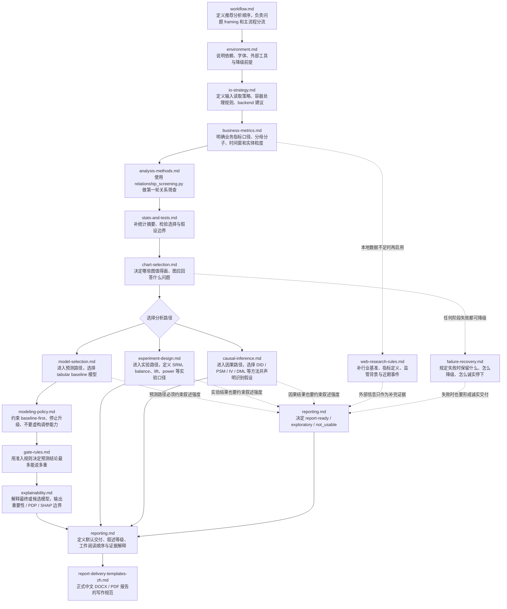

# data_analysis_pro References 流程图

这份文档把 `data_analysis_pro/references/` 里的文件整理成一个统一流程。

结论先说在前面：

- 当前 `references/` 里没有哪一份是“完全没必要”的。
- 但它们不适合被理解成一条纯串行流水线。
- 更准确的结构是：
  - 主流程节点
  - 三类专项分支：预测 / 实验 / 因果
  - 跨阶段守则：环境、失败恢复、外部研究、报告策略

## 总体流程图

## 文件在流程中的角色

| 文件 | 在流程中的位置 | 作用 |
|---|---|---|
| `workflow.md` | 主入口 | 定义推荐顺序、问题 framing、什么时候转入预测/实验/因果路径 |
| `environment.md` | 主流程前置 | 说明环境依赖、字体、外部工具和降级条件 |
| `io-strategy.md` | 主流程前置 | 说明输入格式、目录/ZIP 处理、读取计划和 backend 建议 |
| `business-metrics.md` | 主流程早期 | 统一业务指标口径，防止分母分子、时间窗、实体粒度错位 |
| `analysis-methods.md` | 主流程探索 | 用 `relationship_screening.py` 做第一轮线索筛查 |
| `stats-and-tests.md` | 主流程探索 | 补统计摘要、检验选择和统计边界，不夸大“已内建能力” |
| `chart-selection.md` | 主流程探索 | 选择图表表达方式，让图服务于问题而不是服务于形式 |
| `model-selection.md` | 预测分支 | 说明当前真实的 tabular baseline 能力 |
| `modeling-policy.md` | 预测分支 | 约束 baseline-first、何时停止升级、不要虚构调参能力 |
| `gate-rules.md` | 预测分支 | 定义 baseline gate / stability gate / feature risk gate |
| `explainability.md` | 预测分支 | 解释模型结果，明确原生重要性、permutation、PDP、SHAP 的边界 |
| `experiment-design.md` | 实验分支 | 定义实验分析口径、SRM、balance、lift、power 等关键检查 |
| `causal-inference.md` | 因果分支 | 定义因果方法选择、识别假设和结果防护准则 |
| `web-research-rules.md` | 跨阶段补充 | 只有本地数据不足时才补外部定义、benchmark、背景和事件 |
| `failure-recovery.md` | 跨阶段守则 | 规定失败时如何降级、如何保留工件、如何诚实停下 |
| `reporting.md` | 交付主节点 | 定义默认交付物、叙述等级、工件阅读顺序和证据解释 |
| `report-delivery-templates-zh.md` | 正式交付规范 | 约束正式中文 DOCX / PDF 报告的写法和内容结构 |

## 为什么这 17 个文件都还能保留

这些文件现在都能在统一流程中找到位置，但分工不同：

- 串行主线：
  - `workflow.md`
  - `environment.md`
  - `io-strategy.md`
  - `business-metrics.md`
  - `analysis-methods.md`
  - `stats-and-tests.md`
  - `chart-selection.md`
  - `reporting.md`
- 专项分支：
  - `model-selection.md`
  - `modeling-policy.md`
  - `gate-rules.md`
  - `explainability.md`
  - `experiment-design.md`
  - `causal-inference.md`
- 横向守则：
  - `web-research-rules.md`
  - `failure-recovery.md`
- 交付支持：
  - `reporting.md`
  - `report-delivery-templates-zh.md`

## 本次没有强行排除的文件

本次我没有把任何 reference 判成“完全没必要”。

但有几个文件需要特别说明：

- `analysis-methods.md`
  - 内容已经有用，但文件名偏旧，实际讲的是 `relationship_screening.py`
- `reporting.md`
  - 现在有用，而且已经合并了报告策略与工件解读，但仍不是导出系统说明书
- `report-delivery-templates-zh.md`
  - 现在有用，但它是写作规范，不是执行流程

## 当前仍然不在流程图里解决的真实缺口

这个流程图解决的是“references 怎么协同”，不是“能力缺口已经补齐”。流程图之外仍有几类真实缺口：

- `report_export.py`、`formal_report_export.py`、`report_index.py`、`run_pipeline.py` 等脚本仍不存在
- `baseline_runner.py`、`gate_evaluator.py` 仍是 helper，不是稳定 CLI
- `experiment_analysis.py` 和 `causal_analysis.py` 虽然已有最小 smoke test，但还没有覆盖全部配置分支
- `SKILL.md` 已增加 reference 导航，但仍依赖 Agent 按需选择而不是强制串行读取

## 一句话判断

`references/` 现在已经可以被看成“一个统一流程里的不同节点和守则”，不需要再拆出第二层状态机文档。
